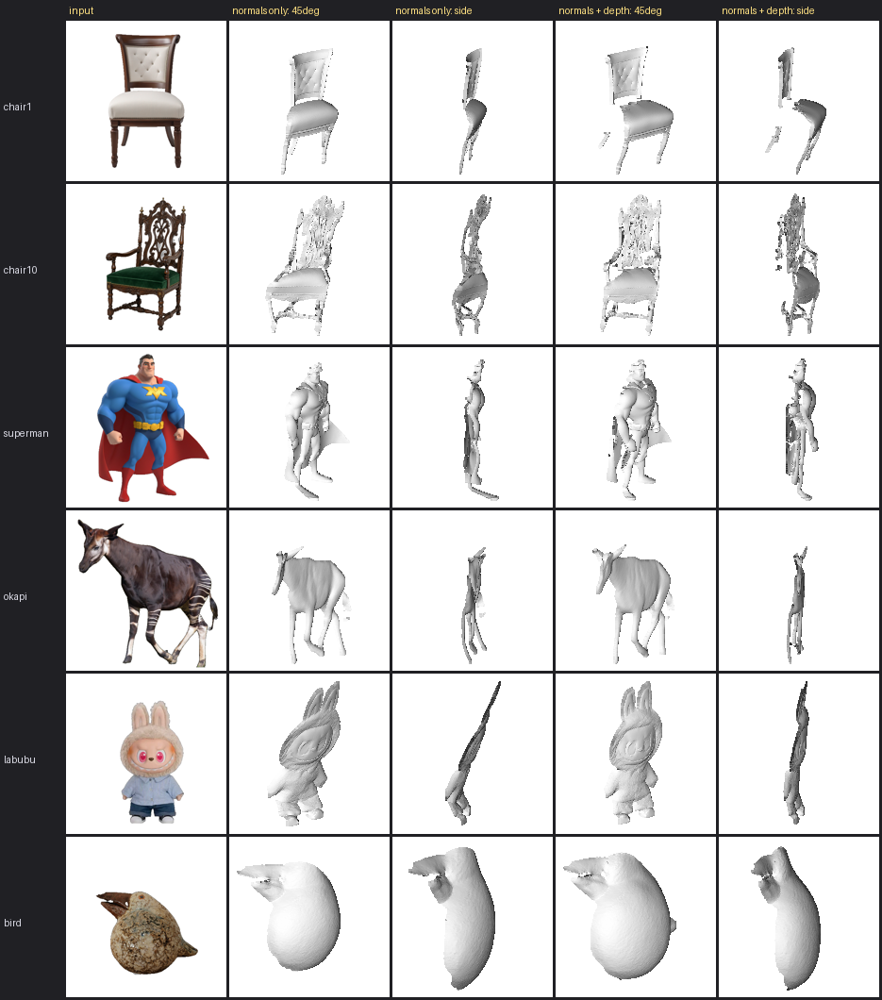

# Textured mesh generation by single image decomposition

From one RGB photo of an object, this project builds a 3D mesh of the object's visible surface and
colours it with the object's albedo (its own colour with the lighting removed). A pretrained diffusion
model, IDArb, splits the photo into albedo and surface normals; the normals are integrated into a depth
map by Poisson normal integration, helped by a monocular depth map from Depth Anything V2 where parts of
the object hide each other.

The repository keeps the name of the original project title, `albedo-relight`; relighting has since been
dropped from the scope.



*Left to right: input, mesh from normals only (45° and side view), mesh with the depth prior (45° and
side view). With normals alone the chair is a thin sheet; the depth prior puts the seat in front of the
back (depth-to-width ratio 0.28 to 0.82) and removes labubu's tilt.*

## How to run

The work is split between a GPU server, which runs the neural networks, and a laptop, which builds the
meshes. Results move between them through git. Full details, options and environment setup are in
[`scripts/idarb/README.md`](scripts/idarb/README.md).

**1. Decompose the photos (GPU server, `idarb` environment, in `third_party/IDArb/`).**

```bash
python ../../scripts/idarb/prepare_images.py --input mydata/raw --output mydata/my_single
python main.py --data_dir mydata/my_single --output_dir output/my_single --input_type single
```

`prepare_images.py` removes the background; `main.py` writes one four-panel image per photo (albedo,
normal, metallic, roughness).

**2. Estimate depth maps (GPU server, `idarb` environment, repository root).**

```bash
python scripts/idarb/estimate_depth.py --input_dir results/idarb_single/inputs --out_dir results/idarb_single/depth
```

**3. Build the meshes (laptop, `mesh` environment, repository root).**

```bash
conda create -n mesh python=3.10 -y && conda activate mesh
pip install -r scripts/idarb/requirements-local.txt
python scripts/idarb/normal_to_mesh.py \
    --result_dir results/idarb_single/decomposition --input_dir results/idarb_single/inputs \
    --depth_dir results/idarb_single/depth --out_dir outputs/mesh_depth
```

Each object gets `outputs/mesh_depth/<name>/relief.ply` (the coloured mesh), `depth.png` and
`preview.png`. Open the PLY files in MeshLab. The 19 sample images in `results/idarb_single/` are
enough to run step 3 without a GPU.

**Checks.** `python scripts/idarb/normal_to_mesh.py --selftest` integrates an ideal hemisphere and a
two-sphere occlusion scene with known depth. `pytest tests/ -q` runs the same checks as tests.

## Layout

| Path | Contents |
|---|---|
| `scripts/idarb/` | the scripts above, plus evaluation scripts that reproduce the numbers in the report |
| `tests/` | pytest tests for the normal integration |
| `third_party/IDArb/` | vendored IDArb code; the first commit is unmodified upstream, later commits are ours |
| `results/idarb_single/` | 19 sample inputs, their IDArb decompositions and depth maps |
| `results/analysis/` | evaluation results (CSV) and failure-case analyses |
| `docs/decisions.md` | dated technical decisions |
| `NOTICE.md` | sources and licenses of third-party code, models and data |

## Failure cases

On 3 of the 19 sample images (cat2, cat3, cat4) IDArb predicts normals that almost all face the camera.
The integrated surface is then a flat sheet, and the depth prior cannot help, because its scale is fitted
to the normal slopes and also drops to almost zero. See
[`results/analysis/failure_cats.md`](results/analysis/failure_cats.md). Other limitations: only the
visible front surface is rebuilt, and parts hidden behind others (such as a chair's back legs) are placed
at the right depth but are not connected to the rest.
